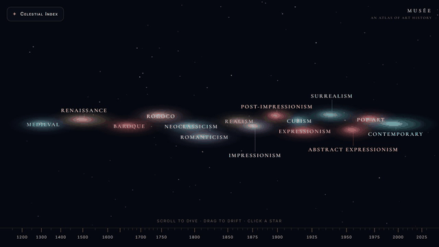
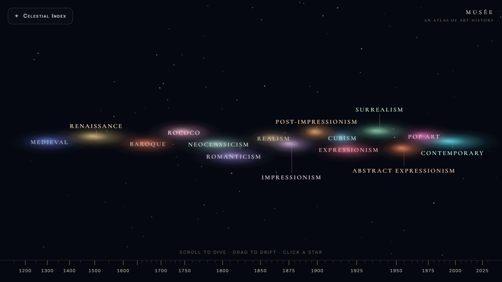
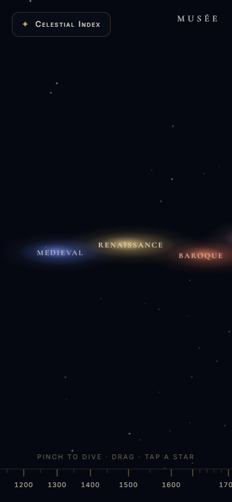
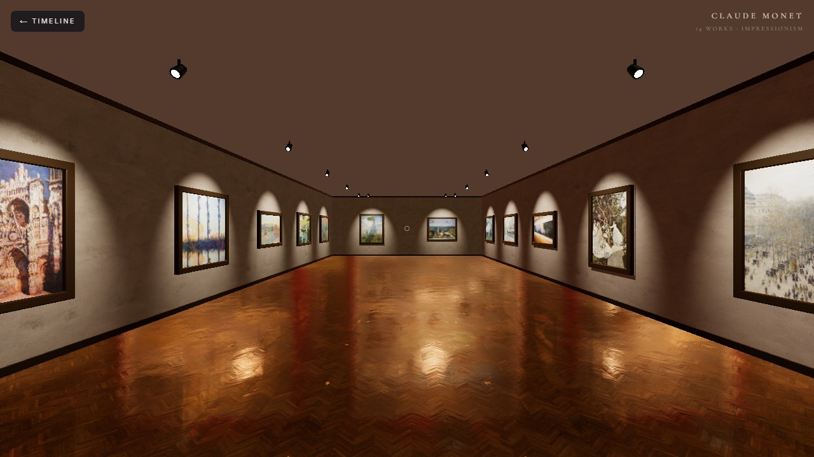

# Musée

A zoomable night-sky timeline of Western art from 1200 to today: dive into a period, click an artist's star, and walk through a first-person 3D gallery hung with that artist's real works from Wikimedia Commons.

**Live:** https://art-history-museum-nine.vercel.app



## What's in it

The collection in [`data/collection.json`](data/collection.json) has 15 periods (Medieval & Gothic to Contemporary), 60 artists (four per period) and 838 works.

- **Timeline.** Each period is a nebula on a year axis. Zooming in (scroll or pinch) brings up each artist as a star, placed at the middle of their working years. Labels never overlap: they move to free rows, get a thin leader line back to their nebula, and hide while there is no room for them. The axis is piecewise linear. On a straight 1000–2030 axis, the four periods before 1750 took more than half the width and the eleven after it were squeezed into the last quarter. The ruler now changes scale at 1450, 1650, 1750, 1850, 1900 and 1960, and 1750–2030 gets about two thirds of the width.
- **Artist card.** Portrait, dates and the opening of the Wikipedia article.
- **Gallery.** One room per artist (React Three Fiber). Walk with WASD and the mouse, then click a painting to see it large with its story, date, license, author and a link to its Commons file page.

| Opening view, 1280×720 | Phone, 390×844 | Inside Monet's gallery |
| --- | --- | --- |
|  |  |  |

The goal is to see at a glance who was painting at the same time as whom, and then step into one painter's room instead of scrolling through a grid of thumbnails.

## Run it locally

Needs Node 22 and pnpm 9. No database or API keys:

```bash
git clone https://github.com/appleweiping/art-history-museum.git
cd art-history-museum
pnpm install
pnpm dev            # http://localhost:3000
```

Without `DATABASE_URL` every page reads `data/collection.json`. The images themselves load from `upload.wikimedia.org`, so you need to be online.

## Where the data comes from

`pnpm seed` builds the collection from English Wikipedia, Wikidata and Wikimedia Commons. It does not write any text itself. An image is only accepted if Commons lists it as public domain, CC0, CC BY or CC BY-SA. Every work keeps its license, author and file-page link. Because of that rule, painters whose work is still under copyright (Picasso, Pollock, Rothko, Warhol, Magritte, …) have no rooms. The modern periods use artists whose work is now in the public domain (Léger, Gris, Tanguy, Gorky, …), plus public sculpture photographed under freedom of panorama (Calder, Moore, Gormley, Saint Phalle, …).

In the snapshot, 563 works are public domain, 37 are CC0 and 238 are CC BY or CC BY-SA.

To rebuild it you need a Postgres database (the live site uses [Neon](https://neon.tech)):

```bash
echo DATABASE_URL=postgres://... > .env.local   # never commit this
pnpm db:push          # create the tables
pnpm seed             # dry run: fetch and validate, no writes
pnpm seed --write     # upsert into Postgres
pnpm snapshot         # refresh data/collection.json from the database
```

The seeder caches every API response under `.cache/wiki/` and uses a small request pool with a descriptive User-Agent. It refuses to write unless at least 12 periods each have at least 3 artists with at least 8 works. With `DATABASE_URL` set, the pages read Postgres instead of the snapshot. The live site works this way.

## Checks

```bash
pnpm test        # axis and label-layout unit tests (node:test)
pnpm typecheck
pnpm lint
pnpm build       # pre-renders the timeline and all 60 gallery pages
```

GitHub Actions runs all four on every push. `pnpm qa` runs the Playwright suite against a running site (`BASE_URL=http://localhost:3000 pnpm qa`). It covers the timeline, the filter, the artist card, the gallery, the inspect view, and a check that no two visible labels overlap at 1280×720 or 390×844. The gallery tests need a GPU. Set `QA_SOFT_GL=1` to use SwiftShader instead (much slower).

## Why not Google Arts & Culture?

It has far more material and better photography. Musée is much smaller and open source, with one specific layout: one shared time axis, then one room per artist, built only from images you are free to reuse.

## Stack

Next.js 15 (App Router, static generation), React 19, TypeScript, Tailwind 4. The timeline is SVG with `d3-zoom` and GSAP camera flights. The gallery uses React Three Fiber and drei with Poly Haven PBR textures, baked spotlights, a reflective parquet floor and pointer-lock controls. Data lives in Neon Postgres with Drizzle ORM, or in the JSON snapshot.

## License

Code: MIT, see [LICENSE](LICENSE). Artwork images keep their own Commons licenses (shown in the app). Wikipedia texts in `data/collection.json` are CC BY-SA 4.0. Wall and floor textures and the HDRI are from [Poly Haven](https://polyhaven.com) (CC0).
